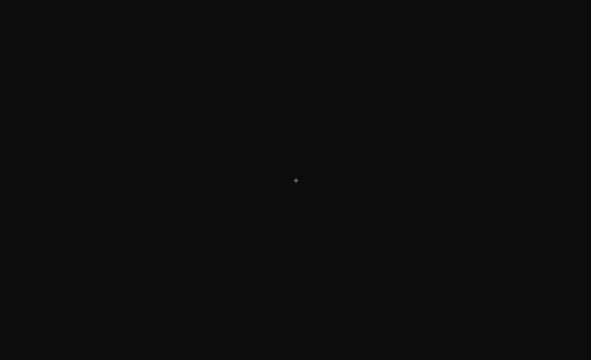
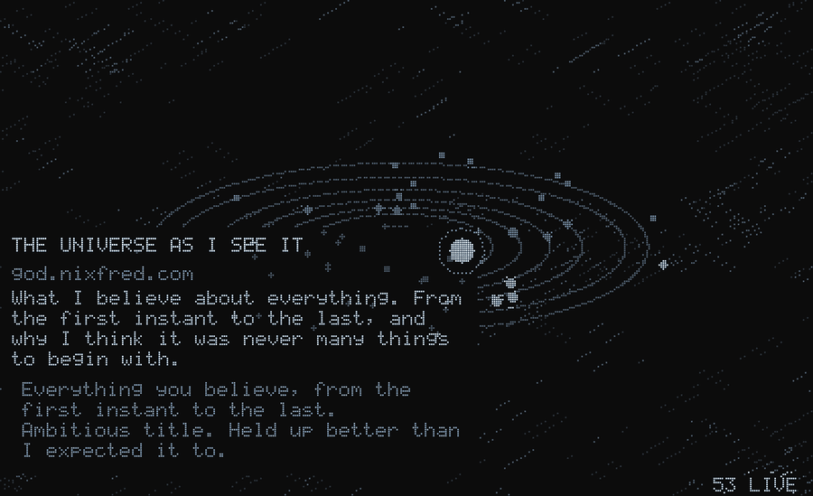
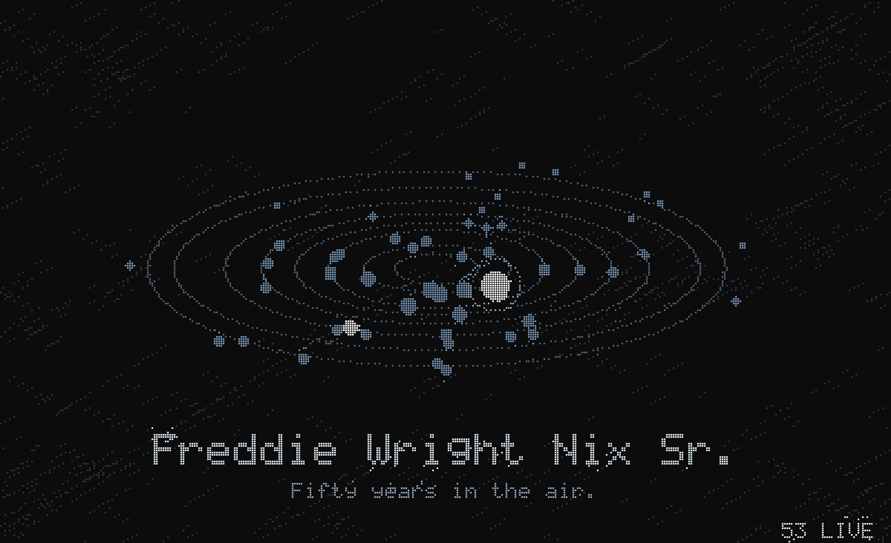
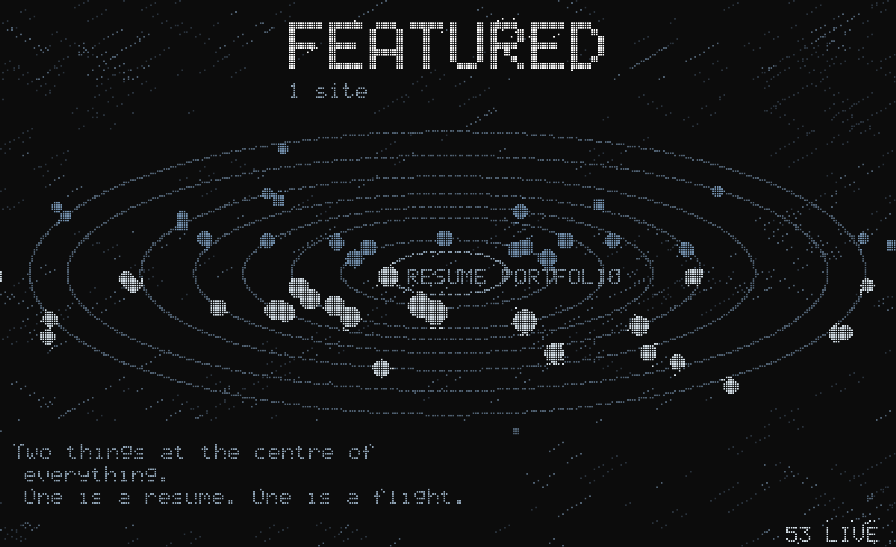
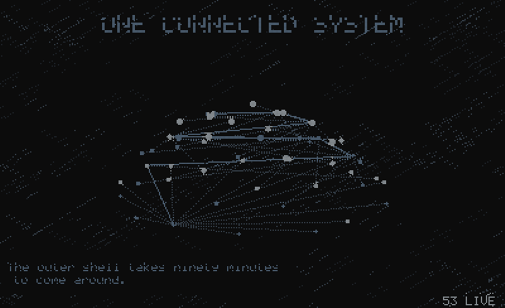
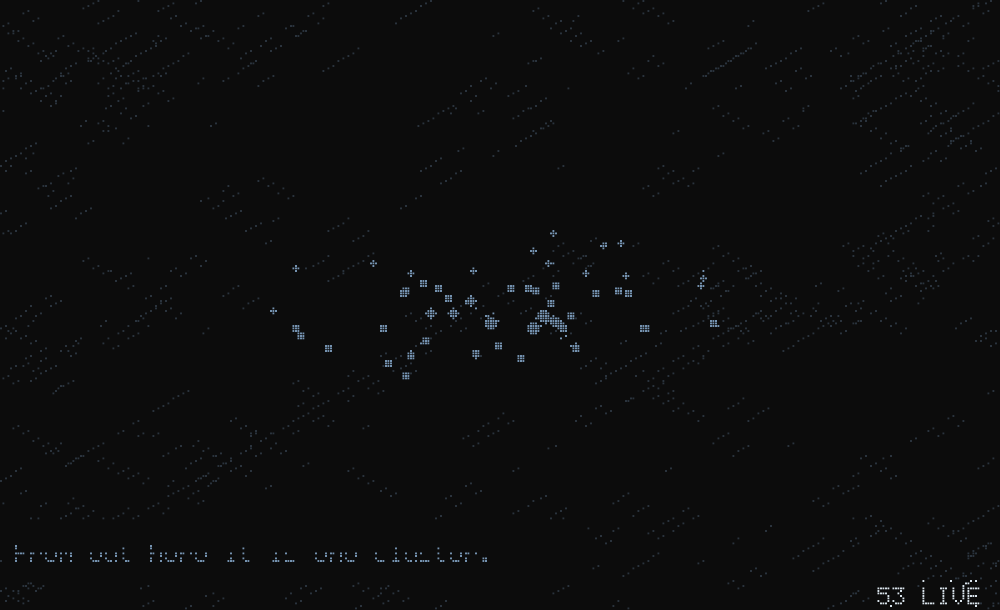
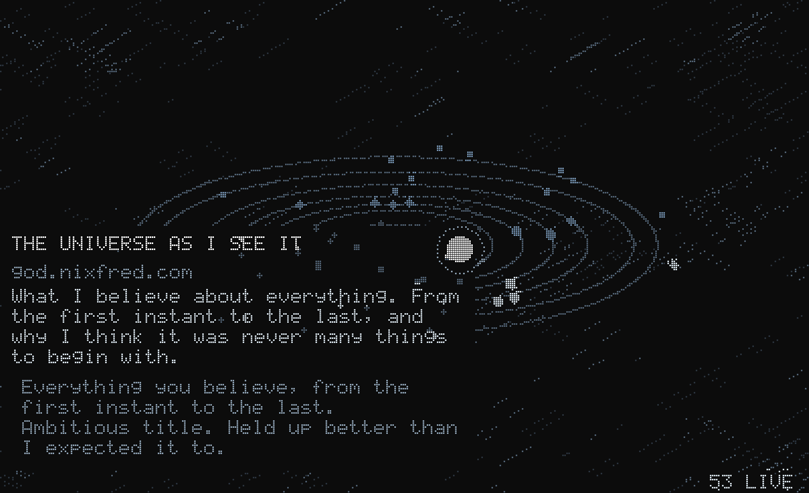

<h1 align="center">ORRERY</h1>

<p align="center">
  <em>The nixfred fleet as an orbital model, for the idle screen on <code>dex</code>.</em>
</p>

<p align="center">
  
</p>

<p align="center">
  <sub><b>COLD START</b> — black, one dot, dust, then the shells draw themselves<br>
  outermost inward until all 53 sites are turning.</sub>
</p>

---

An orrery is a mechanical model of a solar system — a thing you can watch turn.
This one is built from `https://nixfred.com/sites.json`, the master registry
behind nixfred.com, so every site in the fleet is a body in it. Add a site to
the registry and a star appears here. There is no second list.

Larry narrates. He is pre-written and cached, never generated live.

<p align="center">
  
</p>

<p align="center">
  <sub><b>THE TOUR</b> — it settles on each of the 52 in turn: title, host,
  description, and what Larry makes of it.</sub>
</p>

## It does not loop, it descends

Six movements, about 16 minutes before the last one, which never ends.

| # | Movement | Length | What happens |
|---|----------|--------|--------------|
| 0 | COLD START | 0.3 min | Black, one dot, dust, then the shells draw themselves outermost inward and the fleet populates |
| 1 | THE TOUR | 4.8 min | Settles on each of the 52 in turn: title, host, description, Larry |
| 2 | SECTION DIVES | 5.0 min | Drops into each of the eight shells and lets it fill the frame |
| 3 | THE GALAXY | 2.6 min | Orbits dissolve into the wiring and the whole thing rotates |
| 4 | DEEP FIELD | 3.8 min | Pulls back until the fleet is one cluster |
| 5 | THE LONG NIGHT | forever | Minimum energy. Mostly silence |

Those are the lengths at the default speed (`BASE_SPEED = 4.0` in
`orrery/main.py`). The movements were originally timed at 1.0, which read as
static on a real screen. Card fades are a fraction of each card's own dwell
time rather than a fixed number of seconds, so a site stays fully readable
for about 4.6 s at x1 no matter how the speed is set.


### The aircraft

`dad.nixfred.com` is not a body and does not orbit anything. It crosses the
whole field corner to corner every seven minutes or so, on a timer that never
synchronises to the movements, in every movement including the last. While it
crosses, the field yields and the card reads only the name and *Fifty years in
the air.*

<p align="center">
  
</p>

Larry has no line for it. That is enforced in `orrery/larry.py`, not left to
the data — `for_site("dad")` returns nothing, always.

## The other movements

<table>
<tr>
<td width="50%"></td>
<td width="50%"></td>
</tr>
<tr>
<td><b>SECTION DIVES</b> — drops into each of the eight shells and lets it fill the frame, labelling what it holds.</td>
<td><b>THE GALAXY</b> — the orbits dissolve into the wiring and the whole thing turns.</td>
</tr>
<tr>
<td></td>
<td></td>
</tr>
<tr>
<td><b>DEEP FIELD</b> — pulls back until the whole fleet is one cluster. Then <b>THE LONG NIGHT</b>, which never ends.</td>
<td><b>A card</b> — title, host, description, and Larry, over a scrim so the field does not print through the text.</td>
</tr>
</table>

## Install

```bash
./install.sh      # takes over idle; fully reversible
./uninstall.sh    # hands it back to Omarchy
```

`install.sh` touches nothing under `/usr/share/omarchy`. It takes over idle
the supported way: `omarchy plugin clone omarchy.idle` makes a user-owned
copy of the idle service in `~/.config/omarchy/plugins/`, and only that copy
is edited (with a timestamped backup). `omarchy update` cannot clobber it.

It also repoints every *other* configured launcher in `shell.json` — the
hot-corner command, for instance — so the orrery is genuinely the default and
not merely what happens when you walk away. Anything holding
`omarchy-launch-screensaver` or `omarchy launch screensaver` is rewritten,
after a timestamped backup of `shell.json`.

The idle timeout is Omarchy's own, in `~/.config/omarchy/shell.json` under
`idle.screensaver`.

## Commands

```bash
orrery-launch              # start it now, on every monitor
orrery-stop                # stop it
orrery --act 3             # preview a movement in the current terminal
orrery --seek 412          # jump to a point in the program
orrery --speed 16          # override the base speed (default 4)
orrery-refresh             # re-pull the registry (awake only)
orrery-refresh --larry     # ...and write Larry lines for any new sites
```

## Controls

| Key | Does |
|-----|------|
| `Esc` | Stop it. The only thing that does. |
| `↑` | Faster — x1 → x2 → x3 → x4 → x5 |
| `↓` | Slower — back down to x1 |

The mouse does not stop it. Moving it, clicking it, typing any other key, and
the window losing focus all do nothing. A brief `x3` shows in the top right
when the speed changes, so an arrow press visibly lands.

`~/.local/share/orrery/exit.log` records one line per stop and why. Set
`ORRERY_INPUT_TRACE=/path` to log every byte the terminal delivers, which is
how you tell a real keypress from a stray escape fragment.

### Why the input layer is a real tokeniser

Escape and the arrow keys share a first byte, and a `read()` can land
anywhere inside a sequence, so `orrery/input.py` consumes only complete
sequences and buffers partial ones. A lone `ESC` that nothing completes
within 250 ms is the Escape key; one completed by `[A` was an arrow.

Three things arrive on stdin that are not a person touching the machine, and
are swallowed:

- **The terminal's own replies** — foot answers the cell-geometry query with
  `CSI 6;h;w t` and sends `CSI I` whenever the window takes focus.
- **Mouse reports** — motion and clicks both, since neither stops it.
- **Pointer warps** — mapping a fullscreen window and focusing a monitor both
  move the cursor, and Hyprland animates the warp.

### Losing focus

Since focus loss no longer stops it, a fullscreen window that quietly stopped
receiving keys would be unstoppable except through `orrery-stop`. So it asks
Hyprland for focus back every two seconds, and if it cannot get it for 45
seconds it exits rather than sit there uncloseable.

## How it draws

A sparse braille canvas with frame differencing, in pure Python, no
dependencies. Braille gives 2x4 dots per cell, so a 200x61 terminal is a
400x244 dot canvas. Only cells that changed since the last frame are
emitted, which is what keeps a starfield affordable without numpy.

Every glyph is drawn into that dot buffer with a built-in 5x7 font rather
than printed as terminal text, so text size is independent of the terminal
font. That is why `config/foot-orrery.ini` runs at 12pt: a smaller cell buys
resolution, and titles scale themselves up regardless.

Worst measured frame: **19 ms** at 400x244 (24 fps budget is 41 ms).

## Nothing goes out while idle

The screensaver reads local files and the local Tailscale daemon. It makes
no network requests. `orrery-refresh` is the only thing that fetches, and it
runs on demand while the machine is awake.

Site health in the HUD is therefore *last known*, from `lastVerified` in the
registry — the HUD says `verified 25d`, never `live`, because nothing
checked.

## Layout

```
bin/orrery            entry point
bin/orrery-launch     fullscreen on every monitor, class org.omarchy.screensaver
bin/orrery-stop       tear down
bin/orrery-refresh    rebuild the local cache (the only thing that fetches)
orrery/canvas.py      sparse braille compositor, frame diffing, palette
orrery/font.py        5x7 bitmap font
orrery/model.py       fleet, orbital mechanics, the aircraft, camera
orrery/acts.py        the six movements
orrery/input.py       escape-sequence tokeniser: Esc quits, arrows set speed
orrery/larry.py       commentary selection, and the dad silence rule
orrery/hud.py         status line, local sources only
tools/render_frames.py  renders frames to PPM with no screen and no font,
                      by painting the dot buffer straight to pixels
data/fleet.json       bundled registry snapshot (fallback)
data/larry.json       seed commentary
config/foot-orrery.ini
```

## Palette

Straight off nixfred.com: `#0C0C0C` ground, `#D7E2EA` primary, `#8FA3B5`
muted, `#28C840` healthy, `#FF5F57` down.
